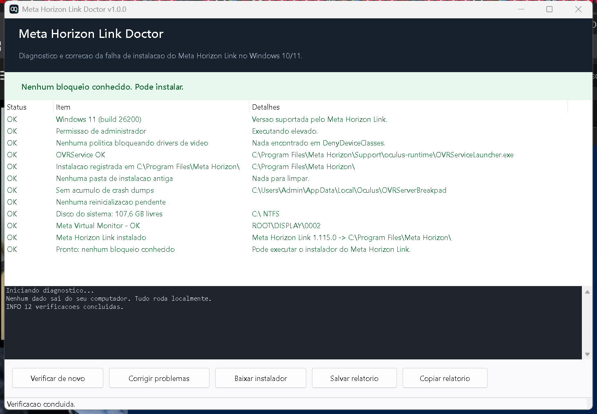

# Meta Horizon Link Doctor

[](https://github.com/akumanfrancisco/meta-horizon-link-doctor/actions)

**🇺🇸 English** · **🇧🇷 [Português](README.pt-BR.md)**

A Windows 10/11 utility that **finds and fixes the real cause** of the
**Meta Horizon Link** (formerly Oculus Link) install failure — the one where the
installer downloads everything, reaches the end, and rolls everything back
without telling you why.

<p align="center">
  
</p>

---

## The problem

The Meta installer (`Setup.exe` / "Dawn") downloads the packages, installs the
drivers, and only then installs the runtime. If **any** driver fails, it
**rolls back the entire installation** and shows only *"something went wrong,
please restart"*.

In practice, the most common blocker is this, from the Windows
`setupapi.dev.log`:

```
dvi:  Searching for hardware ID(s): root\metavirtualscreendriver
dvi:  Class GUID of device changed to: {4d36e968-e325-11ce-bfc1-08002be10318}
pol:  The device is explicitly restricted by the following policy settings:
pol:  [-] Restricted setup class of selected driver: {4d36e968-...}
pol:  {Device installation policy check [ROOT\DISPLAY\0002] exit(0xe0000248)}
dvi:  Installation of device is blocked by policy. Error = 0xE0000248
```

The installer must create the **"Meta Virtual Monitor"** device
(`ROOT\DISPLAY\...`), which belongs to the **Display adapters** setup class. If
a Windows policy blocks that driver class, Windows refuses with `0xE0000248` and
the installer aborts.

The policy lives at:

```
HKLM\SOFTWARE\Policies\Microsoft\Windows\DeviceInstall\Restrictions\DenyDeviceClasses
```

It is usually created by driver-update "tweaks", video-driver blocking tools, or
third-party configuration. It **also breaks Virtual Desktop** and other virtual
display drivers.

> Full investigation with all the log evidence: **[docs/ROOT-CAUSE.md](docs/ROOT-CAUSE.md)**

## What the app does

It runs entirely locally (no telemetry) and checks 12 things:

| Check | Can fix? |
|---|---|
| Windows 10/11 and minimum build | — |
| Administrator rights | — |
| **Policy blocking display drivers (`DenyDeviceClasses`)** | ✅ removes only the offending value, with a `.reg` backup |
| **`OVRService` pointing to a missing file / user folder** | ✅ removes only the service registration |
| Inconsistent install registry (`HKLM\...\Oculus\Base`) | — |
| **Leftover install folders** (Downloads, Desktop, other drives) | ✅ renames to `*.old-<date>` (does not delete) |
| **OVRServer crash dump pileup** | ✅ deletes only the `.dmp` files |
| Pending reboot | — |
| Free space / NTFS on the system drive | — |
| "Meta Virtual Monitor" device state (PnP) | — |
| Installed Meta Horizon Link version | — |
| Final verdict: safe to install or not | — |

Everything it changes is **reversible** and listed in the report.

## How to use

1. Download `MetaHorizonLinkDoctor.exe` from the **[Releases](../../releases)** page.
2. Double-click it and accept the UAC prompt (it needs administrator to read/write
   `HKLM` and services).
3. Click **Fix problems** (if anything is red/amber).
4. Click **Get installer** and run the official Meta installer.

The interface is automatically in Portuguese or English, depending on your
Windows language (override with the environment variable `MHDOCTOR_LANG=en`).

### "Windows protected your PC"

The `.exe` is not code-signed (a code-signing certificate costs money), so
Windows shows that warning for any freshly downloaded executable. The source is
public and you can build it yourself with `build.ps1`.

Every release also publishes a `SHA256SUMS`, so you can verify it:

```powershell
Get-FileHash .\MetaHorizonLinkDoctor.exe -Algorithm SHA256
```

### Command line (for support threads)

```text
MetaHorizonLinkDoctor.exe --scan                 # diagnose only, writes mh-doctor-report.txt
MetaHorizonLinkDoctor.exe --fix                  # fix everything and write the report
MetaHorizonLinkDoctor.exe --scan --out C:\temp\r.txt
```

Exit code: `0` = no blockers, `2` = blockers found.
In `--scan` mode **nothing is changed**.

There is also a read-only script to paste into an issue:
[`scripts/diagnose.ps1`](scripts/diagnose.ps1).

## What it does NOT do

- It does not download or install Meta Horizon Link for you (that is the official
  installer's job).
- It does not touch already-installed display drivers or uninstall anything.
- It does not send telemetry or access the internet (except the "Get installer"
  button, which opens Meta's website in your browser).

## Build

Requirements: Windows + Visual Studio 2022 (or Build Tools) with the
*.NET desktop development* workload — **no .NET SDK needed**.

```powershell
powershell -ExecutionPolicy Bypass -File build.ps1
# optional: -Version 1.2.3 -OutputDir .\dist
```

Output: `dist\MetaHorizonLinkDoctor.exe` (~80 KB, runs on any Windows 10/11 with
the built-in .NET Framework 4.8).

The workflow in [`.github/workflows/build.yml`](.github/workflows/build.yml)
builds and publishes a release on every `v*` tag. Release notes are taken from
`docs/release-notes/<tag>.md` when that file exists.

## Repository layout

```
src/                     C# source (WinForms, .NET Framework 4.8)
build.ps1                build script (uses the Visual Studio csc.exe)
scripts/diagnose.ps1     read-only diagnostic
docs/                    root cause, evidence and the original investigation scripts
assets/                  icon and screenshot
```

## Contributing

Open an issue using the template and **paste the report generated by the app**
(*Copy report* button). It contains exactly what is needed to diagnose the
problem, without personal data.

## License

MIT — see [LICENSE](LICENSE).

Not affiliated with, endorsed by, or sponsored by Meta Platforms, Inc.
"Meta", "Meta Horizon", "Meta Quest" and "Oculus" are trademarks of their
respective owners.
